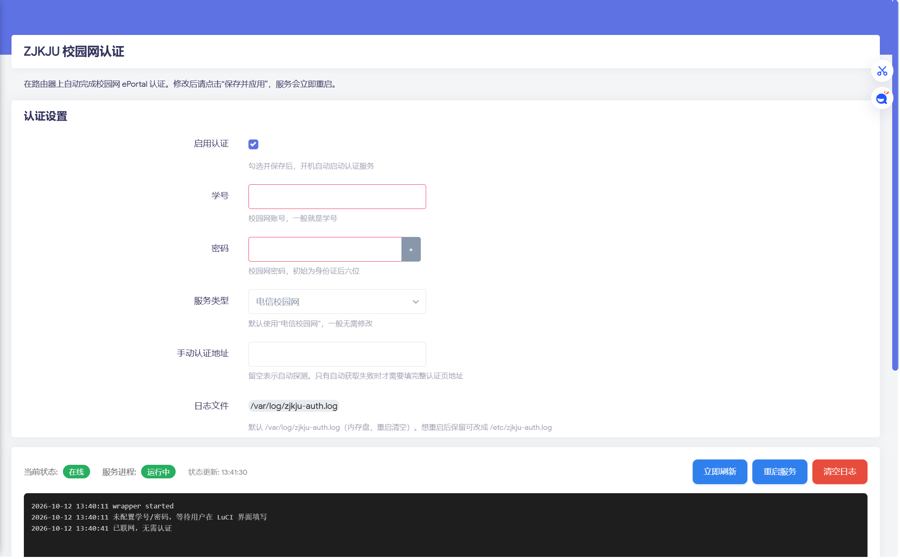

<p align="center">
  
</p>

# LuCI App - 湛江科技学院锐捷校园网自动认证 (luci-app-zjkju-auth)

一个用于 ImmortalWrt / OpenWrt 的 LuCI 应用，在后台自动完成湛江科技学院锐捷 ePortal Web 认证，支持断线自动重连、开机自启、图形化配置和在线更新。

本项目的核心认证逻辑基于上游项目 [Micro-Cnhua/Ruijie_Porta_Auth](https://github.com/Micro-Cnhua/Ruijie_Porta_Auth)（该上游又参考了 [Turris-Babel/school_ruijie](https://github.com/Turris-Babel/school_ruijie)），也一定程度上参考了本校前辈的思路 [ZJKJU-Network-Login](https://github.com/YaYa404/ZJKJU-Network-Login)。我们在其基础上将其封装为 OpenWrt 软件包，并增加了 LuCI 图形界面和自动重连 wrapper。

> ⚠️ 本项目仅针对湛江科技学院（ZJKJU）锐捷 ePortal Web 认证进行适配。其他学校的锐捷 Web 认证页面如果结构相同，理论上也能使用，但需要自行测试。


## 📷 界面预览

- **菜单**：服务 → ZJKJU 校园网认证
- **两个标签页**：认证设置 / 其他设置
- **实时状态**：在线状态 + 服务进程状态
- **运行日志**：实时查看认证日志，每 10 秒自动刷新，支持一键清空
- **在线更新**：检查更新、显示进度、一键升级




## ✨ 特性

### 认证

- ✅ **全架构通用**：shell + curl 实现，一个包支持所有 CPU 架构（ARM / MIPS / x86）
- ✅ **自动认证**：开机自启动，断线自动重连（默认 10 秒检测一次）
- ✅ **三层 URL 兜底**：自动抓取 / 缓存兜底 / 手动地址
- ✅ **智能检测**：双 DNS ping + HTTP 兜底
- ✅ **失败熔断**：连续认证失败自动冷却，避免高频请求校园网关
- ✅ **进程守护**：procd 守护，崩溃自动重启；配置变更后自动重启服务

### 界面

- ✅ **两个标签页**：认证设置 / 其他设置，字段分组清晰
- ✅ **实时状态徽章**：通过 procd 的 ubus 接口判断进程状态，不会误报
- ✅ **日志面板**：页面内查看日志，立即刷新 / 重启服务 / 清空日志
- ✅ **清空即清除**：清空学号密码并保存后，配置项会被真正删除

### 更新

- ✅ **在线更新**：检查更新 → 显示更新内容 → 一键下载安装
- ✅ **直连优先 + 代理交叉验证**：直连失败时通过多个加速节点校验 sha256，防止被篡改
- ✅ **真实下载进度**：显示百分比，不是估算
- ✅ **测试版通道**：默认只推正式版，可选开启接收 pre-release

## 💻 支持平台

| 项目 | 版本 |
|------|------|
| 系统 | ImmortalWrt / OpenWrt **23.05 ~ 25.12+** |
| 包格式 | ipk（opkg）、apk（apk） |
| CPU 架构 | **全架构通用**（aarch64 / armv7 / mips / mipsel / x86_64） |
| 依赖 | `luci-base`、`luci-compat`、`curl` |

> 本包为 **shell + Lua + JavaScript 实现**，不含任何预编译二进制，因此一个包通吃所有 CPU 架构。
>
> 23.05 起 LuCI 默认使用 JS 前端，传统 Lua CBI 由 `luci-compat` 提供，安装时会自动拉取。
> 21.02 及更早版本没有 `luci-compat`，不在支持范围内。

## 📥 下载

进入 GitHub 仓库的 **Releases** 页面下载最新构建产物：

| 文件名 | 适用系统 | 架构 |
|--------|----------|------|
| `luci-app-zjkju-auth_1.0.5-r1_all.ipk` | 使用 opkg 的系统（23.05 ~ 24.10） | **全架构** |
| `luci-app-zjkju-auth-1.0.5-r1.apk` | 使用 apk 的系统（25.12+） | **全架构** |

Beta 版本以 `-beta` 结尾并标记为 pre-release，需在「其他设置」中开启「接收测试版」才会收到更新提示。

## 🚀 安装

### 1. 上传安装包到路由器

```bash
scp luci-app-zjkju-auth_1.0.5-r1_all.ipk root@192.168.1.1:/tmp/
```

### 2. SSH 登录路由器安装

```bash
# opkg 系统（23.05 / 24.10）
opkg update
opkg install /tmp/luci-app-zjkju-auth_1.0.5-r1_all.ipk

# apk 系统（25.12+）
apk add --allow-untrusted /tmp/luci-app-zjkju-auth-1.0.5-r1.apk
```

如果提示缺少依赖，先执行：

```bash
# opkg 系统
opkg install luci-compat curl

# apk 系统
apk add luci-compat curl
```

### 3. 登录 LuCI 配置

浏览器打开 `http://192.168.1.1`（你真实的路由器后台地址）→ **服务 → ZJKJU 校园网认证**

在「认证设置」标签页中：

- **启用**：勾选
- **用户名**：填你的学号
- **密码**：填你的密码
- **服务类型**：保持默认「电信校园网」
- **手动认证地址（可选）**：留空则自动抓取

点击 **保存并应用**，服务会自动启动。

## 🗑️ 卸载

提供两种方式，清理范围一致（配置、日志、进程、缓存、界面全部清掉）。

### 方式一：包管理器卸载（推荐）

```bash
opkg remove luci-app-zjkju-auth
# 或 25.12+ 的 apk 系统
apk del luci-app-zjkju-auth
```

卸载时自动执行 `postrm` 钩子，静默完成全部清理。

> ⚠️ **升级安装不会触发清理**，配置会保留。只有 `remove` 才清理。

### 方式二：独立脚本（排障用）

```bash
/usr/bin/zjkju-auth-uninstall.sh
```

会打印 7 步进度和最后的验证结果，适合包数据库损坏、`opkg remove` 失败时使用：

```
[1/7] 停止服务并清理进程...      ✅
[2/7] 卸载软件包...              ✅
[3/7] 删除配置和系统脚本...      ✅
[4/7] 删除可执行文件...          ✅
[5/7] 删除 LuCI 界面文件...      ✅
[6/7] 清理历史运行残留...        ✅
[7/7] 清理包管理器记录与缓存...  ✅
```

脚本会先把自身复制到 `/tmp` 再执行，避免被 `opkg remove` 删掉导致中断。

### 清理内容

| 类别 | 路径 |
|---|---|
| 配置 | `/etc/config/zjkju-auth` |
| 服务 | `/etc/init.d/zjkju-auth`、`/etc/uci-defaults/80_zjkju-auth` |
| 程序 | `/usr/bin/zjkju-auth-wrapper.sh`、`/usr/bin/ruijie` |
| 界面 | `menu.d`、`acl.d`、`controller`、`model/cbi`、`view` |
| 日志 | `/var/log/zjkju-auth/`、`/var/log/zjkju-auth.log` |
| 运行时 | `/tmp/zjkju-*` 全部残留 |
| 缓存 | `luci-indexcache`、`luci-modulecache`、`opkg/info` 记录 |

### 完成后

浏览器按 `Ctrl + Shift + R` 强制刷新，左侧菜单「ZJKJU 校园网认证」应立即消失。

## 🖥️ 使用说明

### 两个标签页

| 标签页 | 内容 |
|--------|------|
| **认证设置** | 启用、用户名、密码、服务类型、手动认证地址 |
| **其他设置** | 接收测试版、日志文件位置、版本更新 |

### 状态徽章

页面顶部有 **当前状态** 和 **服务进程** 两个徽章，每 5 秒刷新一次。

**当前状态**：

| 徽章 | 含义 |
|------|------|
| 🟢 **在线** | 网络已连接，认证有效 |
| 🔴 **离线** | 检测到掉线，正在自动重新认证 |
| 🟠 **冷却中** | 连续认证失败，正在冷却等待 |
| ⚫ **已禁用** | 「启用」未勾选，服务已停止 |
| ⚪ **未配置** | 学号或密码未填写 |
| ⚪ **未知** | 检测失败（服务刚启动或异常） |

**服务进程**：

| 徽章 | 含义 |
|------|------|
| 🟢 **运行中** | wrapper 进程在运行 |
| ⚫ **未运行** | 进程已停止 |

> 💡 **「已禁用」和「未运行」的区别**
> - **已禁用**：你取消了「启用」，服务**主动不启动**
> - **未运行**：你启用了服务，但进程**意外退出了**

### 日志面板

页面底部显示最近 100 行认证日志，每 10 秒自动刷新：

| 按钮 | 功能 |
|------|------|
| **立即刷新** | 手动拉取最新日志 |
| **重启服务** | 重启认证服务，冷却中的失败计数清零 |
| **清空日志** | 一键清空日志文件 |

### 在线更新

在「其他设置」→「检查更新」中点击 **检查更新**：

1. 有新版本时会弹出窗口，显示更新内容
2. 点击 **立即更新**，按钮会依次显示 `下载中 45%` → `校验中` → `安装中` → `完成，刷新中...`
3. 安装完成后服务会自动重启，页面自动刷新

更新过程会：
- 优先直连 GitHub API，失败时通过加速节点交叉验证 sha256
- 校验安装包完整性，不匹配会中止
- 拒绝降级（不会把新版本"更新"回旧版本）


## 📂 文件位置速查

| 用途 | 路径 |
|------|------|
| 配置文件 | `/etc/config/zjkju-auth`（权限 600，仅 root 可读） |
| 服务脚本 | `/etc/init.d/zjkju-auth` |
| 认证脚本 | `/usr/bin/zjkju-auth-wrapper.sh` |
| 运行日志 | `/var/log/zjkju-auth/auth.log` |
| 当前状态 | `/var/log/zjkju-auth/status` |
| 认证地址缓存 | `/var/log/zjkju-auth/last-url` |
| 对时标记 | `/var/log/zjkju-auth/clock-ok` |

> ⚠️ `/var/log` 位于内存盘，**重启后日志会清空**。升级安装包时也会清空一次。

## ⚙️ 工作原理

本项目由三个组件构成：

| 组件 | 职责 |
|------|------|
| `zjkju-auth-wrapper.sh` | shell 脚本，循环检测在线状态；掉线时抓取最新 URL；用 curl 发送认证请求 |
| LuCI 前端 | 配置界面 + 状态指示 + 日志查看 + 在线更新 |
| procd 服务 | 守护 wrapper 进程，崩溃自动重启；配置变更后自动重启 |

### 智能在线检测（双 DNS + HTTP）

```
① ping 223.5.5.5（阿里主 DNS）→ 通就认为在线
② ping 223.6.6.6（阿里备 DNS）→ 通就认为在线
③ HTTP 访问 msftconnecttest.com 确认 → 防 ICMP 被拦误判
```

流量消耗约 20 MB/月。

### 三层 URL 兜底

1. **自动抓取**：访问普通外网（baidu / example / qualcomm / neverssl / qq），从 302 响应中提取带 `wlanuserip` 的认证页 URL
2. **缓存兜底**：使用上次认证成功时缓存的 URL（`/var/log/zjkju-auth/last-url`）
3. **手动 URL**：前两层都失败时，才使用 LuCI 里填的手动地址

### 为什么不用 `-e` 持久化模式？

上游 `ruijie` 的 `-e` 模式进入循环后**永远使用最初传入的 URL**。但学校掉线后 `wlanuserip` 等参数会变化，旧 URL 会失效。因此我们用 wrapper 重新实现了循环，每次掉线都重新抓取最新 URL。

### 为什么用 shell 实现？

上游使用 Go 语言实现，每个架构需单独编译（2 MB/架构），且需要 Go 编译环境。改用 shell + curl 后：一个包全架构通用（约 20 KB），无需 Go 编译环境，认证逻辑与上游完全一致。

### 失败熔断保护

为防止**学号密码错误时高频请求学校认证接口**，脚本内置轻量熔断机制：

| 场景 | 行为 |
|------|------|
| **认证成功** | 失败计数清零 |
| **网关明确返回 fail**（密码错、服务类型错） | 失败计数 +1 |
| **连续 3 次业务失败** | **冷却 300 秒**，日志提示检查配置 |
| **网络波动、拿不到 URL、响应无法识别** | **不计入熔断**（避免误锁） |

冷却期间，**在 LuCI 修改学号/密码并保存，最多 10 秒自动结束冷却重新认证，无需重启服务**。

> ⚠️ 仅检测学号、密码变更；修改服务类型、手动认证地址不会提前结束冷却。

## 🛠️ 自行编译

### 使用 GitHub Actions 云编译（推荐）

1. Fork 本仓库
2. 进入 **Actions** → 选择 **测试（ipk + apk）** → **Run workflow**
3. 选择发布通道：
   - `beta` → 生成 `v1.0.5-r1-beta`，标记为预发布
   - `stable` → 生成 `v1.0.5-r1`，正式版
4. 等待约 10 分钟，产物自动发布到 Releases

发布说明取自 `.github/RELEASE_NOTES.md`，发版前修改该文件即可。

### 本地编译（需要 OpenWrt SDK）

```bash
# 1. 下载对应 SDK
wget https://downloads.immortalwrt.org/releases/24.10.6/targets/mediatek/filogic/immortalwrt-sdk-24.10.6-mediatek-filogic_gcc-13.3.0_musl.Linux-x86_64.tar.zst
tar --use-compress-program=unzstd -xf immortalwrt-sdk-*.tar.zst
cd immortalwrt-sdk-*/

# 2. 拉取 feeds
./scripts/feeds update -a
./scripts/feeds install -a

# 3. 放置本包
mkdir -p package/luci-app-zjkju-auth
cp -r /path/to/luci-app-zjkju-auth/* package/luci-app-zjkju-auth/

# 4. 编译
make package/luci-app-zjkju-auth/compile V=s

# 5. 产物在 bin/packages/<arch>/base/ 下
```

## 📁 项目结构

```
luci-app-zjkju-auth/
├── .github/
│   ├── RELEASE_NOTES.md                    # 发布说明（发版前修改）
│   └── workflows/测试.yml                   # GitHub Actions 云编译
├── Makefile                                # OpenWrt 包定义
├── luasrc/
│   ├── controller/zjkju-auth.lua           # 接口：状态 / 日志 / 重启 / 更新
│   ├── model/cbi/zjkju-auth/main.lua       # 配置表单
│   └── view/zjkju-auth/
│       ├── log.htm                         # 状态徽章 + 日志面板
│       └── update.htm                      # 版本更新弹窗与脚本
└── root/
    ├── etc/
    │   ├── config/zjkju-auth               # UCI 默认配置
    │   ├── init.d/zjkju-auth               # procd 服务脚本
    │   └── uci-defaults/80_zjkju-auth      # 首次安装初始化
    └── usr/
        ├── bin/zjkju-auth-wrapper.sh       # 自动重连 wrapper（核心）
        └── share/
            ├── luci/menu.d/                # LuCI 菜单注册
            └── rpcd/acl.d/                 # LuCI 权限声明
```

## ❓ 常见问题

**Q：日志一直很安静，是不是服务挂了？**

A：**看顶部状态徽章**。🟢 在线说明服务正常。在线时 wrapper 静默检测，不输出日志 —— 这正是优化后的效果。

**Q：掉线后多久能恢复？**

A：**最多 10 秒**。wrapper 每 10 秒检测一次，检测到掉线立即认证。但学校网关如果有"观察期"（2-3 分钟），实际恢复时间可能更长。

**Q：保存时提示「没有待应用的更改」？**

A：说明表单内容和当前配置一致，LuCI 认为无需提交。改任意一个字段后再保存即可。
保存后会显示原生进度提示「正在应用配置更改… Ns」。

**Q：清空学号密码后，刷新页面还是显示旧内容？**

A：那是**浏览器自动填充**。清空后按 `Ctrl + F5` 强制刷新即可确认。
命令行验证：`uci get zjkju-auth.main.username`，返回 `Entry not found` 表示已清空。

**Q：流量消耗大吗？**

A：**极小**。使用双 DNS ping 检测，在线时每次只发一个 ICMP 包（约 100 字节），每月约 20 MB。

**Q：安装后 LuCI 里看不到菜单？**

A：浏览器缓存问题。按 `Ctrl + Shift + R` 强制刷新，或退出 LuCI 重新登录。

**Q：升级后学号密码会被清空吗？**

A：**不会**。`/etc/config/zjkju-auth` 属于 conffiles，升级时保留。
但 `/var/log/zjkju-auth` 会被清空（日志属于运行时数据）。

**Q：支持其他学校吗？**

A：理论上只要认证页面结构相同就能用，但需要自行测试。主要差异可能在：

- `service` 参数值（本仓库针对"电信校园网"）
- 认证服务器 IP（本仓库针对 `10.80.80.249`）
- 是否需要 RSA 加密密码（本仓库使用明文，`passwordEncrypt=false`）

如需适配其他学校，修改 `root/usr/bin/zjkju-auth-wrapper.sh` 里的 `AUTH_SERVER` 和 `root/etc/config/zjkju-auth` 里的 `service` 即可，具体方法见下一节。

**Q：25.12 能用吗？**

A：可以。25.12+ 使用 apk 包格式，Release 里同时提供 `.apk` 和 `.ipk`，按你的系统选择即可。

## 🔬 抓包获取 service 值（适配其他学校）

本仓库硬编码的 `service` 值针对湛江科技学院的"电信校园网"。锐捷 ePortal 认证要求 POST 请求里带 `service` 字段，不同学校、不同运营商的值都不一样，必须实测。

常见值：`default`（学生）、`Teacher`（教工）、`电信校园网` / `移动校园网` / `联通校园网`。

### 抓包步骤

**第 1 步：打开抓包**

浏览器按 `F12` → 切换到 **Network（网络）** → 勾选 **Preserve log（保留日志）**

**第 2 步：触发认证**

注销校园网 → 访问 `baidu.com` → 自动跳到认证页 → 输入账号密码，选好服务类型，点登录

**第 3 步：找到 login 请求**

在 Network 面板搜索 `login`，找到 `InterFace.do?method=login`（POST 请求）
右键 → **Copy → Copy as cURL (bash)** → 粘贴到记事本

**第 4 步：提取 service 值**

在 curl 命令里找 `service=` 字段：

```
--data-raw 'userId=xxx&password=xxx&service=%25E7%2594%25B5%25E4%25BF%25A1%25E6%25A0%25A1%25E5%259B%25AD%25E7%25BD%2591&...'
```

把 `%25` 全部替换成 `%`，得到：

```
%E7%94%B5%E4%BF%A1%E6%A0%A1%E5%9B%AD%E7%BD%91
```

**第 5 步：替换代码里的值**

修改 `root/etc/config/zjkju-auth`：

```
option service '新抓的service值'
```

同时修改 `luasrc/model/cbi/zjkju-auth/main.lua` 里的候选值，让界面能显示成中文。

### 快速解码命令

```bash
echo "%25E7%2594B5..." | sed 's/%25/%/g'
```

原理一句话：浏览器发双重编码 → 我们硬编码用单次编码 → curl 再编码一次 → 还原成双重 → 和浏览器一致。

完整数据流：

| 阶段 | 值 |
|------|-----|
| 浏览器选"电信校园网" | 电信校园网 |
| JS 编码（单次） | `%E7%94%B5%E4%BF%A1%E6%A0%A1%E5%9B%AD%E7%BD%91` |
| 表单提交再编码（双重） | `%25E7%2594%B5...%25BD%2591` |
| 我们硬编码存的值 | `%E7%94%B5%E4%BF%A1%E6%A0%A1%E5%9B%AD%E7%BD%91` |
| curl `--data-urlencode` 再编码 | `%25E7%2594%B5...%25BD%2591` ← 和浏览器一致 ✅ |

### 修改认证服务器 IP

如果你们学校的认证服务器不是 `10.80.80.249`，修改 `root/usr/bin/zjkju-auth-wrapper.sh`：

```sh
AUTH_SERVER="http://你们学校的认证服务器IP"
```

改完重新编译即可。

## 🙏 致谢

本项目基于以下开源项目：

- [Micro-Cnhua/Ruijie_Porta_Auth](https://github.com/Micro-Cnhua/Ruijie_Porta_Auth) — 锐捷 ePortal 命令行认证工具（本项目核心认证逻辑来源）
- [Turris-Babel/school_ruijie](https://github.com/Turris-Babel/school_ruijie) — 上游的参考项目
- [ZJKJU-Network-Login](https://github.com/YaYa404/ZJKJU-Network-Login) — 本校前人的贡献
- [SunBK201/UA3F](https://github.com/SunBK201/UA3F) — 参考了其 LuCI 界面的实现思路
- 所有 LuCI 和 OpenWrt 社区的贡献者

## 📄 许可证

本项目采用 **GNU General Public License v3.0**（GPL-3.0）许可证，详见 [LICENSE](./LICENSE) 文件。

## ⚠️ 免责声明

- 本项目仅供学习交流使用，请勿用于商业用途
- 使用本工具可能违反学校网络管理规定，请自行承担风险
- 密码保存在路由器 `/etc/config/zjkju-auth` 中（权限 600，仅 root 可读），请确保路由器安全

<p align="center">
  
</p>
